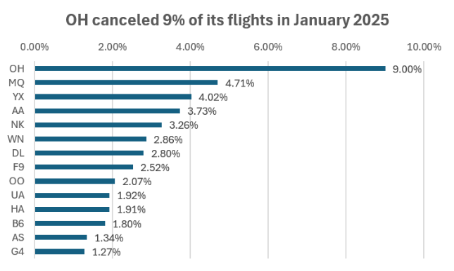
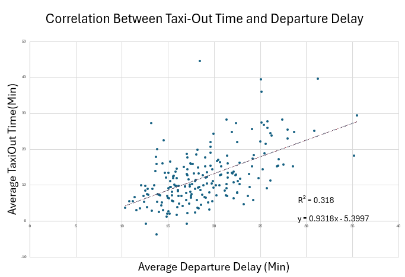

## Data Set:

We used the Bureau of Transportation Statistics (BTS) *Reporting Carrier On-Time Performance* data for January 2025. The data set contains 539,747 domestic flights operated. Each row is one flight, with categorical columns such as airline, origin and destination airport, and scheduled departure time block, and numerical columns such as departure delay, taxi-out time, arrival delay, distance, and cancellation status.

## Question 1: Time-series plot

**How did average arrival delay vary by day during January 2025?**

{fig-alt="Assertion-evidence slide for the time-series question"}

We chose this question because anyone who has experienced a flight delay has probably wondered whether certain days are worse for traveling than others. We wanted to see how average arrival delays changed throughout January 2025 and whether there were particular days when flights experienced significantly longer delays. To answer this question, we created a PivotTable using the flight date as the rows and the arrival delay minutes as the values. We changed the value calculation from sum to average so that we could compare the average arrival delay for each individual day. Blank arrival delay values were automatically excluded from the averages. After calculating the daily averages, we copied the results into a separate worksheet as values and created a line graph to display the changes throughout the month. We placed the dates along the horizontal axis and average arrival delay in minutes along the vertical axis. We also simplified the date labels, added axis titles, and gave the graph a descriptive title to make the information easier to understand. The graph shows that average arrival delays fluctuated throughout January rather than staying consistent. January 6 had the highest average arrival delay at approximately 34.95 minutes, while January 28 had the lowest at approximately 4.07 minutes. The overall average arrival delay for the month was approximately 14.22 minutes.

## Question 2: Bar chart

**Which airlines had the highest cancellation rates during January 2025?**

{fig-alt="Assertion-evidence slide for the bar chart question"}

## Question 3: Scatter plot

**Do airports with longer taxi-out times also experience longer departure delays?**

{fig-alt="Assertion-evidence slide: airports with longer taxi-out times have longer departure delays, shown as a scatter plot of 209 airports with a positive linear trendline"}

We chose this question because anyone who has sat on a runway waiting to take off has wondered whether that time on the ground is a sign their flight is running late. To answer it, we built a pivot table from the data with origin airport as the rows. The values were the count of taxi-out times, the average taxi-out time and the average departure delay. Blank values from cancelled flights were automatically left out of the averages. We applied a value filter to keep only airports with at least 100 flights, so that small airports with only a handful of flights wouldn't skew the results, which left 209 airports. Pivot charts can't be scatter plots, so we pasted the filtered table as values and plotted average taxi-out time against average departure delay, with one point per airport. A linear trendline was added and the R\^2 value displayed to quantify the strength of the relationship. We removed the default chart title and legend, added axis titles in minutes. The plot shows a somewhat positive relationship (R \^2 ≈ 0.32): airports averaging under 15 minutes of taxi-out time had about 8 minutes of average delay, while those averaging 20 minutes or more had about 17.
